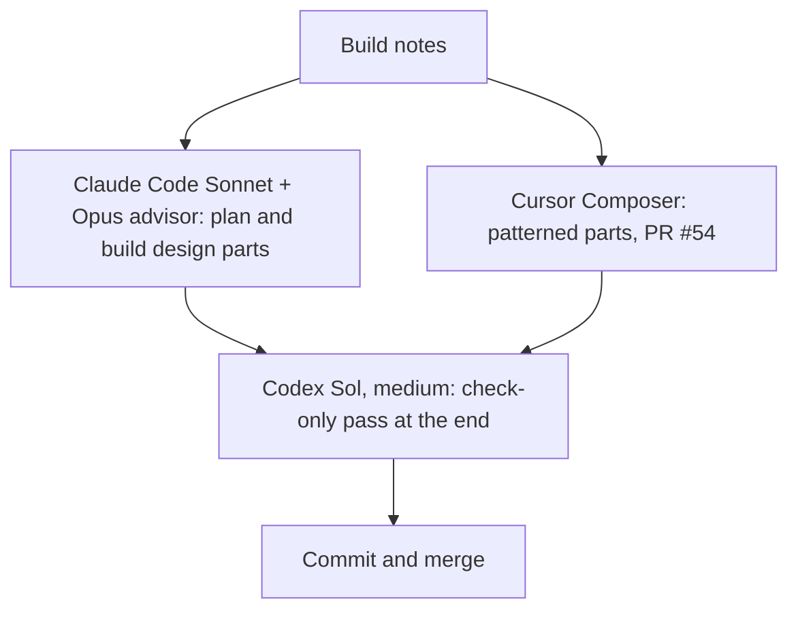

# Fan/Friction: who builds what

> **Oct 13 (Kylie):** Sol's planning step is dropped. Claude plans its own parts; Sol does only the final check. See "Model split final" in `build-notes-4-oct12.md`.

## The models

| Model | Best at | What it costs | Effort | Build 4 parts it owns | If it's unavailable |
|---|---|---|---|---|---|
| **Fable 5.1** (Claude) | Top quality, long specs, design taste | Uses up Claude quota fast | High for read/plan, medium for decided steps | Default builder for everything (out for about 27 hours right now) | Claude Code (Sonnet + Opus advisor) plans and builds design parts; Composer builds the rest |
| **Claude Code** (Sonnet, Opus as advisor) | Strong design and new-feature builds | Claude quota | High | Plans and builds the city view redesign (Map/List, calendar, friend chips), stub tags, New stub sheet; design and Supabase items of P1–P6 | Composer builds these too, with the Sol check |
| **Codex GPT-6.1 Sol** | Careful planning and review | Expensive: one big build used about 20% of the weekly Codex allowance | Medium (high only if the notes conflict) | The final check-only pass only. No planning, never the full build | Wait for the reset |
| **Cursor Composer** | Fast pattern-following code | Cheap: Cursor bar at 2%, monthly | Default | Chicago rebuild, crowd-number fix, copy and data items | Opus, or wait |

## City-build pipeline
1. Do the research first (already done).
2. **Composer** builds the city from the research file, using Milwaukee as the pattern.
3. **Sol** does a check-only pass against the research and Milwaukee, fixing gaps without rebuilding.

## What Claude's plan must have (formerly the Sol plan handoff)
- [ ] Steps in order, with the files each one touches and how to check it's done
- [ ] Every locked decision, quoted from the notes
- [ ] Data and Supabase changes spelled out (tables, columns, RLS)
- [ ] Conflicts found, and how each was resolved
- [ ] Open questions, marked as blocking or not blocking
- [ ] What's out of scope
- [ ] Which builder owns each step
- [ ] The commit plan
- [ ] The rule: if something isn't in the plan, stop and ask; don't guess
