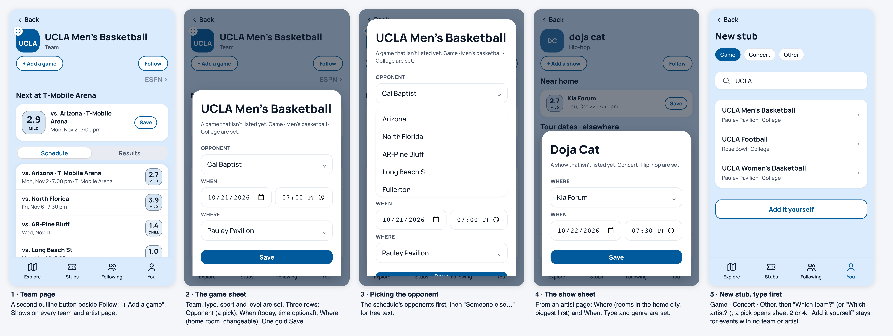
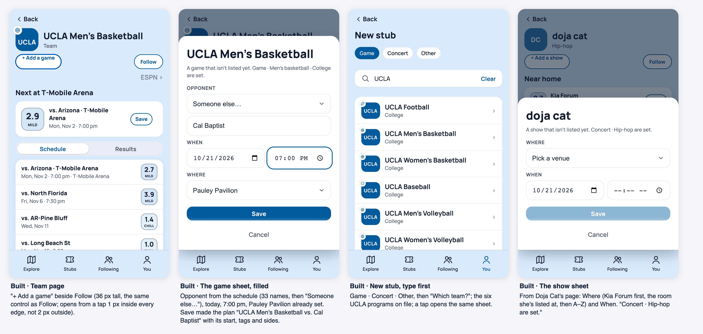
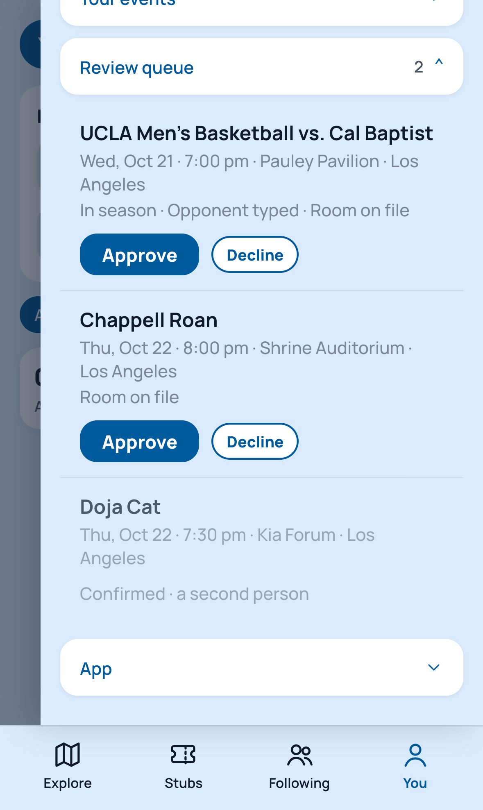

# Adding an event from a team's or artist's page

Status: decided (Kylie, Oct 21, 2026, late evening: both entry points, the card, the inclusion standard and the three confirmations; see product-decisions). Building from Oct 21, late evening. Written Oct 21, 2026 (late evening) by Claude Code, from Kylie's ask the same evening, at UCLA's exhibition against Cal Baptist ("it's like selecting rather than filling out brand new... defaults are already plugged in"), and her word that this is a new event, not only a new stub, so it sits beside build 7's logging work rather than inside it. Nothing is built.

## Why
The feeds now carry most of what happens in a city's rooms (the league feeds, Ticketmaster's match-shaped sports listings since Oct 21, the schools' own calendar feeds since Oct 21). What no public source carries, by decision: shows sold only on AXS, DICE, See Tickets or Tixr (the Shrine's Chappell Roan nights), and box-office games at a school whose site is neither on Sidearm nor an opponent of one. Today those go in through "Add it yourself" on New stub: What, When, City, Where, then a Details block of type, sport, level, division and competition. Too many boxes for someone standing in a stadium (Kylie, Oct 13: "it has to be incredibly simple").

## The mock (phone size, drawn inside the live app)

1. **Team page.** A second outline button beside Follow, "+ Add a game" (artist pages: "+ Add a show").
2. **The game sheet.** The team, the type (Game), the sport and the level are set from the team record and said in one quiet line. Three rows: **Opponent** (a pick), **When** (today, a time, optional), **Where** (the team's home room, changeable: the city's rooms, then "Another venue"). One gold **Save**.
3. **The opponent pick.** The schedule's opponents this season first, then "Someone else…" for free text. Nothing else to type.
4. **The show sheet.** From an artist page: **Where** (the home city's rooms, biggest first) and **When**. Type (Concert) and genre are set from the artist.
5. **New stub, type first.** Game · Concert · Other, then "Which team?" or "Which artist?"; a pick opens sheet 2 or 4 with the same defaults. "Add it yourself" stays for an event with no team or artist.

## Builder's leans, for Kylie to confirm or change
- **What Save makes:** an event in her own log (a plan if ahead, a stub if past), shown to followers the way any plan or stub is, and matched to a listing later if one appears (today's hand-add already matches). It does not enter the shared catalog: anyone adding events everyone sees is open posting (direction.md guardrails). If she wants a hand-added event to be visible on the date page for other people, that is a separate decision.
- **The button's place:** beside Follow, since that row is where the page's actions already sit. The alternative, a line under "Your events", is quieter and easier to miss.
- **No time, no problem:** the time is optional; a game with no time takes the "Time TBA" band on the date page (Oct 16).
- **Exhibition:** not a box. The word in the opponent line ("Cal Baptist (exhibition)") would do, or nothing; the preseason flag is a later nicety.

## Open
- Whether a hand-added event reaches the shared catalog (lean: no; see above).
- Whether the sheet is a bottom card (as drawn) or the full New stub page with the defaults filled.
- The native time control clips "PM" in the mock at 393 px; a real phone shows its own picker.

## Decided (Kylie, Oct 21, 2026, late evening)
Both entry points, the bottom card, Save into the person's own log, and a path to the shared catalog with a standard and a mechanism:

**The standard at Save.** A team or artist on file; a room on file; a date and a time; nothing already listed at that room, date and sport (else it matches the listing); signed in. "Official, ticketed" is enforced by the records, not a box: a sister's high-school game has neither a team nor a room on file (Kylie: "it shouldn't be for random things... official events... ticketed").

**Pending until confirmed, three ways.** (1) A feed catches up and the entry matches its listing (exists). (2) A second account that doesn't follow the first adds the same team, room and date. (3) Kylie approves it: a Supabase row with an approved flag for v1, no admin screen until the queue is busy. Pending shows to the person and their followers, labeled "Added by a fan"; confirmed shows to everyone, sized like any game, label kept.

**Build order.** Step 1: the two entry points, the card, the entry in the log with its qualifying flag and the "Added by a fan · Pending" label. Step 2: the submissions table (SQL for Kylie to paste), the second-person check and the approved rows entering the catalog at the nightly run.

## Built (Oct 21, 2026, late evening; measured in the browser at 393 px)

- **Entry points.** "+ Add a game" / "+ Add a show" beside Follow on a team's or artist's page (`FavoritePage`; on its own row when the record line takes the slot). New stub (`AddEntryScreen`) asks Game · Concert · Other first; Game searches the teams on file ("Which team?"), Concert the artists in your favorites and log and the acts the listings name ("Which artist?"); Other is the search as before. "Add it yourself" stays.
- **The card** (`QuickAddSheet`, a bottom card on the app's dialog styles). Title, "A game that isn't listed yet. Game · Men's basketball · College are set." Opponent (the schedule's opponents, soonest first, then played; "Someone else…" for free text), When (today and an optional time), Where (the home room set; the city's rooms A–Z, the home room or the artist's rooms here first; "Another venue" for free text). One gold Save; Cancel; closes by a tap outside or Escape.
- **Save** (`src/data/quickAdd.ts`): a plan ahead, an entry past, with the start, the team's short name as a filter tag and the sides, so the team's page lists it. When the standard is met (a team on file or an artist with a record or listings; a room on file; a time; signed in) it is also sent for review: the existing `suggested_events` row plus the structured facts (migration `0030`, for Kylie to paste: team, artist, room, start, opponent, sport, level, source). The entry page then reads "Added by a fan · Pending review".
- **Measured:** the Cal Baptist exhibition saved from the UCLA page as a plan with start 19:00, tags ["UCLA MBB"], sides ["UCLA Bruins men's basketball", "Cal Baptist"], venue Pauley Pavilion, and shows on the Stubs timeline; the button is 112 × 36 px and opens from 1 px inside each edge, not from 2 px outside; the Where lists lead with Pauley Pavilion (team) and Kia Forum (Doja Cat's listed room); Concert + "doja" on New stub finds Doja Cat from the listings. `npm run build` and the titles check pass.
- **Not yet (step 2):** the review's three confirmations (a feed catching up already matches; the second-person check and Kylie's approved rows entering the catalog at the nightly run are not built); the pending label needs a signed-in check on a phone; from New stub an artist's Where list is plain A–Z (the page knows her rooms, the search does not yet).

## The review queue and the review window (Oct 21, 2026, late evening; built)

Settings › Review queue, an admin account only. Each row: the title, when and where, the gate's findings in words, Approve / Decline; a decided row shows its status with Undo. Approve writes `approved` on the row; the nightly run writes the event. The board was drawn in the live panel with three example rows (signed out, the real section needs the admin account); the component renders the same markup. The review window at Save is 30 days back and 90 ahead (`REVIEW_WINDOW`); outside it the log keeps the event and nothing is sent.
