# Proposal: "Further out" (regional events), mock for Kylie's yes

Claude Code, Oct 19, 2026 (evening). Mock approved by Kylie Oct 20, 2026 ("fine", with a helper line under the Settings heading); built Oct 20 (see "Built" at the end).

**Updated Oct 20, 2026, midday (Kylie, multiple choice):** separate switches for the map and for lists (date pages, the Explore List, search), both on by default; a favorite's further-out event always shows on its page and Following. The screenshots below are redone to match.

**Decided already (Kylie, Oct 19, 2026, evening, multiple choice):** big events within about a 2-hour drive of a covered city's core show in a "Further out" group on the date page and an optional map layer. They never change the city's verdict (the regional research's rule 3, `docs/build-5/research/regional-events-research-answer.html`). This page is only the look, for her yes before any code (mock first).

## The mock (Los Angeles, Fri Oct 30, 2026, at phone size)

**Date page:** a "Further out" card under the lineup, the same rows as the lineup. The row keeps its crowd and has no friction ring, because it never feeds the verdict. The second line reads the room, the town and the drive.

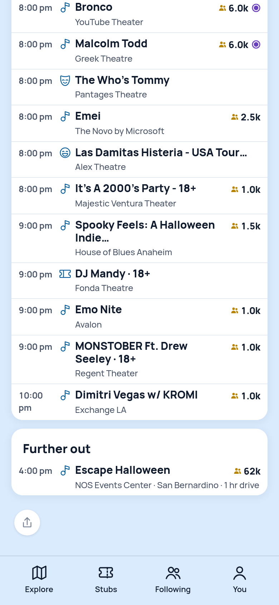

**Explore List:** further-out rows close each day, under a small "Further out" heading, same rows, no ring.

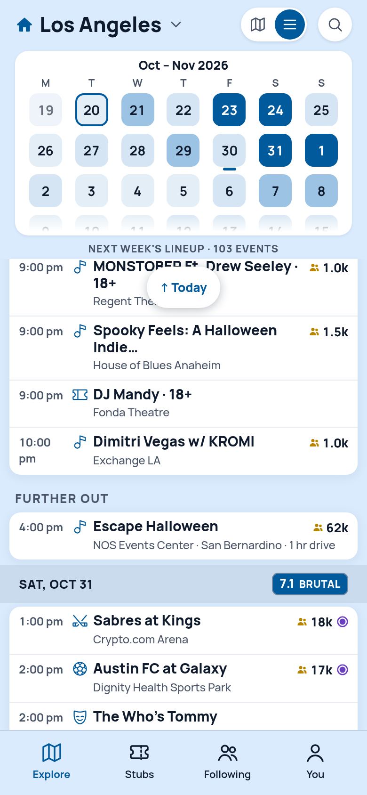

**Settings › Crowd size:** a "Further out" heading with two switches, "Show on the map" and "Show on date pages and lists", both on by default. On the map, further-out events show as muted chips, the way small rooms do, with no friction ring; they sit outside the city, so they only appear when the map is zoomed out.

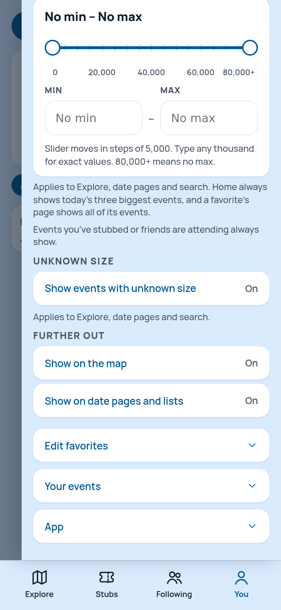

Escape Halloween (Insomniac, NOS Events Center, San Bernardino, Oct 30–31) is the example row: 62k is half of the 125,000 reported over two nights in 2017, labeled estimated. Its tickets sell through Front Gate, which the app can't read (Oct 19 seller-terms decision), so it would come from the hand-kept festival list, not a feed.

## The rule behind it (every city, no hand tuning)

- **What counts:** an event likely at 5,000+ on at least one day, at a room outside every covered city but within about 2 hours' baseline drive of a covered city's core (the city's map center today).
- **The drive:** computed once per room by a script from the city's core and stored with the room, labeled estimated; never a live traffic figure.
- **Where events come from:** the same feeds, reading rooms outside the city once those rooms are on file (the held Inland Empire rooms are the first), plus the hand-kept festival list (Nocturnal Wonderland and Escape Halloween are already marked regional).
- **What it never does:** change the verdict, take a friction word, or count toward the day's total.

## Crowd size takes the same pattern (Kylie, Oct 20, 2026, midday, multiple choice; built Oct 20)

One range, with two switches under it, "Apply on the map" and "Apply on date pages and lists" (search follows lists), both on, so nothing changes until someone turns one off. "Show events with unknown size" stays one switch and filters wherever the range applies. The range's "Applies to Explore, date pages and search" sentence goes; the switches say it. The whole panel:

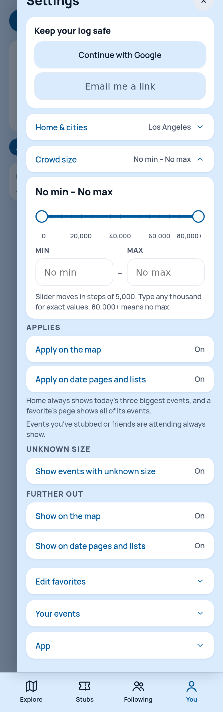

## Leans she may change
- The heading over the range's switches reads "Applies"; the rows say "Apply on…" for the range and "Show on…" for Further out, because one filters and the other adds.
- The card (and the List's heading) shows only when there is at least one further-out event that day, and always sits after the day's own events.
- No line under the switches explaining them (the copy rule: users are not dumb).
- Search follows the lists switch.
- The row's second line: "NOS Events Center · San Bernardino · 1 hr drive". The drive could drop to save space.

## Decided with it
A favorite's further-out event always shows on its page and the Following timeline, whatever the switches say.

## Built (Oct 20, 2026)
- **Data:** a room marked `furtherOut` (drive, town) keeps its city's id so the feeds read it, and never reaches a day, the calendar, search, a stamp, the stamp clock or a gridlock zone. The first rooms are Los Angeles's Inland Empire rooms of 5,000+ (Toyota Arena, San Manuel Stadium, Morongo Field, Fowler Events Center; 63–83 minutes by the routed drive). Only events of 5,000+ show.
- **Date page:** the Further out card under the lineup, behind the lists switch (stubs and friends' plans always show). **Explore List:** a small "Further out" heading closes the day. **Map:** muted chips on the drawing layer only (the camera, the sheet's rows and the day's totals never see them), behind the map switch. **Event page:** a further-out event opens on its own, with no This day card. **Favorites:** its page, the Following timeline and Home's strip include further-out events whatever the switches say. **Settings:** the Further out heading, the helper line and the two switches.
- **Measured** with Los Angeles's live further-out rows on Sat, Nov 7 (Ramon Ayala at Toyota Arena): the verdict reads 4.7 with 25 lineup events with or without the row; the card and the List group show one row and disappear with the lists switch off; the map draws one muted chip with the switch on and none with it off, the header staying at 25 events · 64k. A city event's dot never counts under a further-out chip's "+N" (measured: Brand New reads +6 with the switch on or off, and Ramon Ayala's chip has no badge). A stub on a further-out event settles, takes its crowd and retitles like any other.

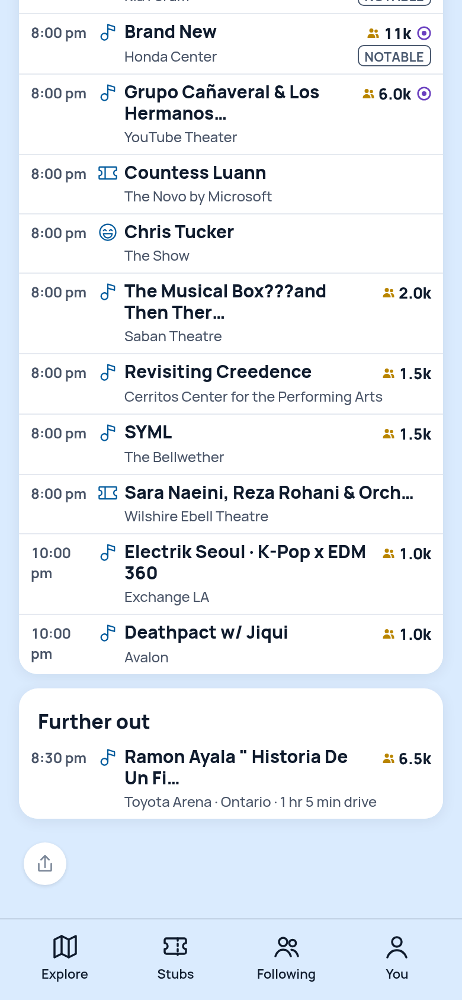

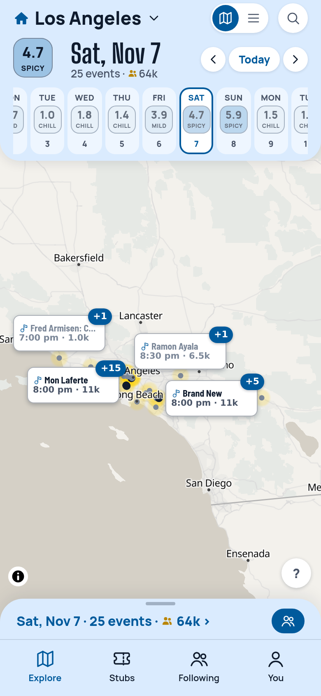

## Three leans for her word (Oct 20, 2026, afternoon; mocks at phone size, nothing built)

**Decided and built (Kylie, Oct 20, 2026, afternoon: "1/ lean 2/ lean minus drive time 3/ lean"):** (1) the shorter line; (2) A without the drive: the header names the town, a quiet "Further out" line under it; (3) B, the plain tile on every row. Product-decisions has the entry.

**1. The helper line** (copy only). Now: "Big events (5,000+) outside the city, within about a 2-hour drive. They're listed for reference and never count toward a date's verdict." ("2-" and "hour" break across lines.) Lean: "Big events (5,000+) within about a 2-hour drive. They never count toward a date's verdict.", with a hyphen that never breaks.

**2. The event page.** Today the header reads "Toyota Arena · 8:30 pm"; nothing says the event is further out, while every list row says "Toyota Arena · Ontario · 1 hr 5 min drive". A (lean): the town in the header and a quiet "Further out · 1 hr 5 min drive" line, no card. B: the same, plus the city's This day card titled "This day in Los Angeles".

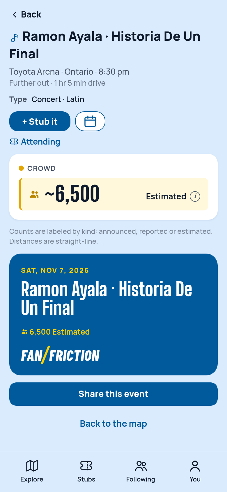

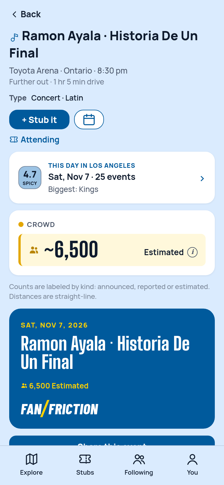

**3. The tile on a further-out stub or plan.** Now it shows the city's verdict (4.7 Spicy), which the event never counted toward. B (lean): a plain tile with no tap, the way an away game outside the covered cities already reads. Whatever she picks goes through one shared rule on every row that carries a tile for an event: Stubs (stubs and plans), Home's stubs and strip, Following and a favorite's timeline (`FollowRow`), Home's friends feed (`FeedRow`), search and Log an event hits, Same tour, Compare and Your year.

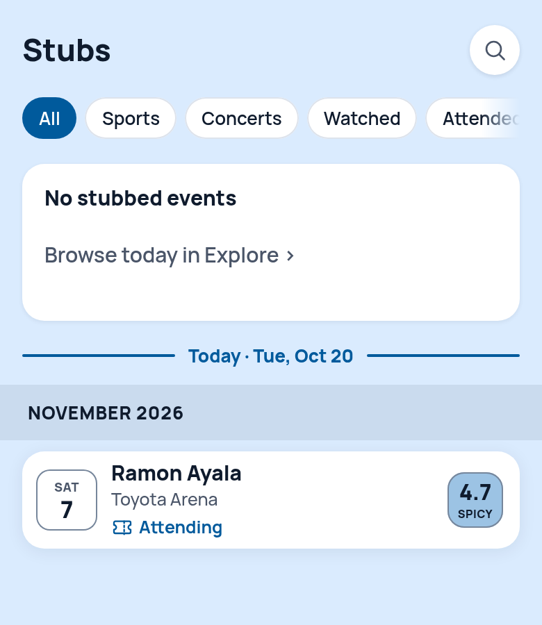

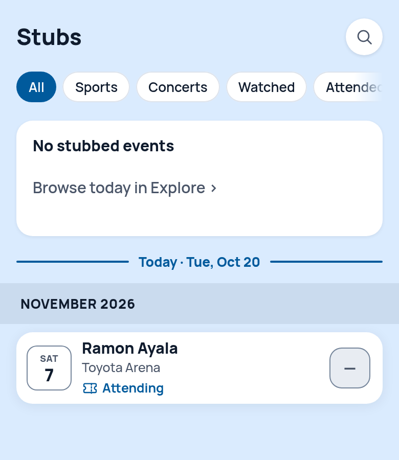

**Search** (built the same day): the search sheet finds further-out events (5,000+) when the lists switch is on ("ramon ayala" finds the Nov 7 Toyota Arena show; off, only Portland's Nov 27 date); logging an event by hand always finds them. **Not built yet:** further-out rooms for other cities (research); Escape Halloween and Nocturnal Wonderland (their grounds are not on file and the festival list is not read by the app yet).

## Where a further-out row's tap goes (Oct 21, 2026, evening; Codex finding 4; nothing built)

**The problem, measured in the browser (Jo Koy, Fri, Dec 11, Toyota Arena, Los Angeles).** Every row that carries a further-out event and opens its date page sends the person to Los Angeles's page for that date. On a favorite's Near home row the event lands 1,483 px down (the viewport is 659 px tall), below a Verdict it never counted toward ("1.7 Chill · Brent Faiyaz pulls on 17 other crowds"), Local Competition and an 18-row lineup, and the row is not tinted (the deep-link tint only knows lineup rows). From Home's Your next event row it is 1,605 px down; a saved plan at least adds the Attending card near the top. The tile on these rows is already plain, as decided.

**Where the pattern appears** (every whole-row link to a date page that a further-out event can reach; one shared rule should cover them all):
- Home: Your next event rows; the favorites-this-week chips; Recent rows (a stub at a further-out room).
- A favorite's page: Near home; Tour dates · elsewhere (a further-out room in another covered city); Upcoming (a venue or festival favorite, such as Toyota Arena itself); Next at home and the schedule rows (a team based at a further-out room, such as the Ontario Reign once its games land); Your events rows.
- An event page's More dates cells (another date of the same tour at a further-out room).
- Already right: search hits (Map and Log an event), the date page's Further out rows, the List's Further out rows, a Stubs plan or stub row (they open the event page); Compare's night cells compare nights, so they stay.

**A (lean): the row opens the event page.** The same place a search hit, a date-page row and a List row already go for a further-out event. The event page names the town, says "Further out", and holds Stub it and Attending. One rule: a further-out event's row opens its event page, every other event's row keeps its date page. **B: the row opens the date page, scrolled to the Further out card, the row tinted.** Rows keep opening dates, but the page still leads with a city verdict the event never counted toward, and the scroll jumps two screens. **C: leave it.**

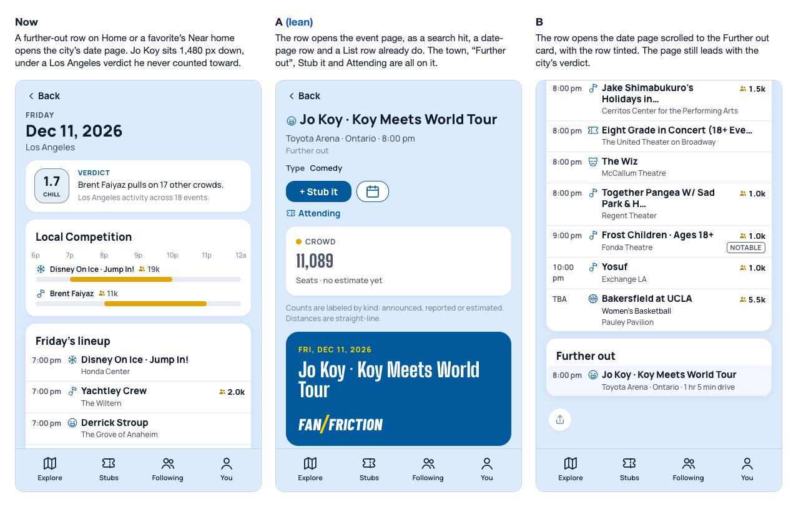

**Decided and built (Kylie, Oct 21, 2026, evening: "i'm good with A"):** one shared rule, `eventRowPath` and `loggedRowPath` in `src/lib/view.ts`, on every row above; measured on Los Angeles (commit `522c08c2`).

## A helper for "Further out" on the event page (Oct 21, 2026, evening; mocks only, nothing built)

Kylie, Oct 21: "i do want a helper that explains Further Out (or points the user to where that's defined?)". Today the event page carries only the quiet line "Further out" (her Oct 20 lean, no drive). The definition lives in one place, Settings › Further out: "Big events (5,000+) within about a 2-hour drive. They never count toward a date's verdict."

- **H1:** the line explains it in one sentence: "Further out · about a 2-hour drive from Los Angeles. Never in a date's verdict." Two lines at phone width; no tap.
- **H2:** the line stays "Further out" and becomes a link; a tap opens Settings › Further out, where the sentence and the two switches live.
- **H3 (lean):** "Further out · never in a date's verdict ›", one line with the reason, and a tap opens Settings › Further out for the full definition. The city's name comes from the event's metro, so the line reads the same in every city.

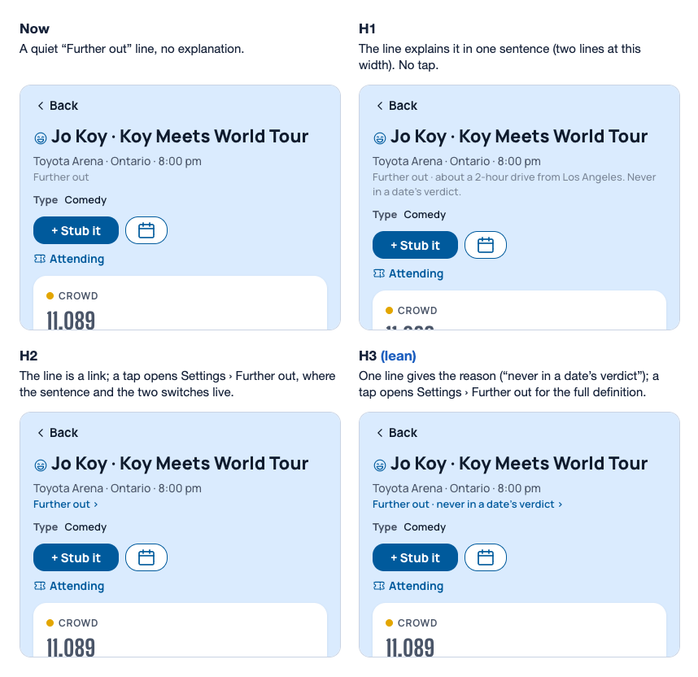

**Kylie, Oct 21, 2026 (evening), on the three forms above:** "i was thinking literally an info icon circle, which would open to a brief explanation (which would contain the same definition as in the settings)". Mocked below with the app's own pieces: the (i) that sits beside an estimated figure, and the small card "About this verdict" uses. The sentence is Settings' sentence, kept in one place so the two can never drift. Awaiting her yes; nothing built.

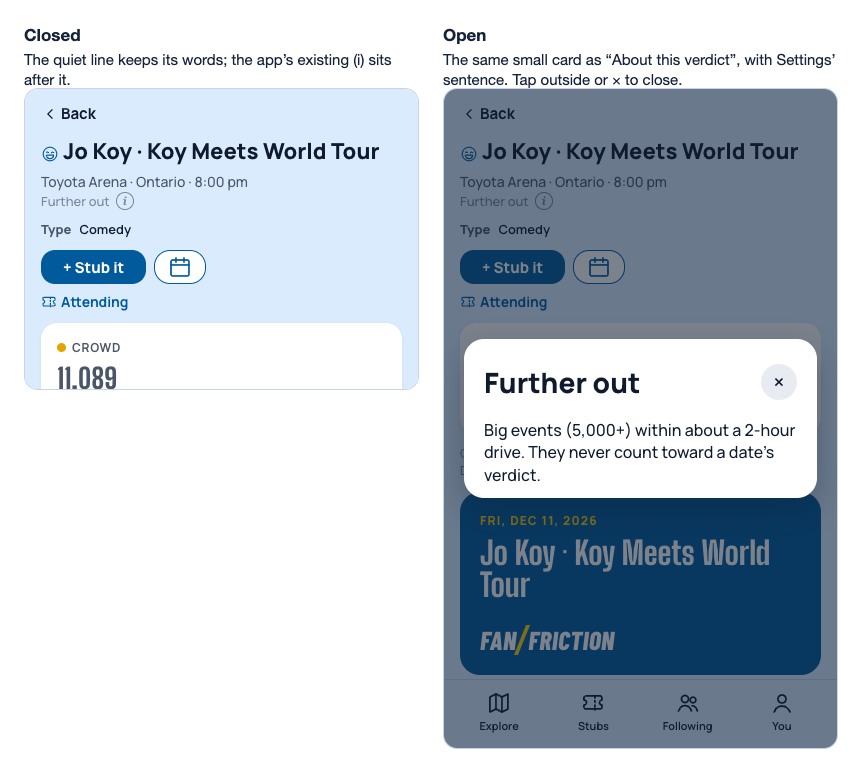
